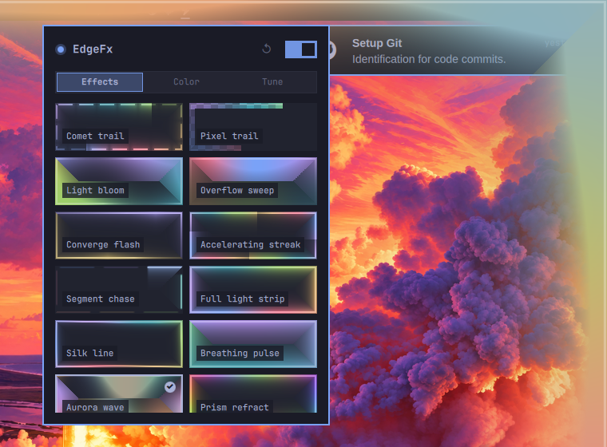

# EdgeFx

GPU-accelerated, theme-aware animated edge lighting for [Omarchy](https://omarchy.org) 4.5 (Quattro). Light up your screen edges, window borders, or both with 22 shader effects, live Omarchy theme colors or your own RGB color, and optional music reactivity.



## Install / remove

```
omarchy plugin add https://github.com/neshath/omarchy-edgefx --enable
omarchy plugin remove io.github.neshath.edgefx
```

Add the **EdgeFx** widget to your bar to get a toggle and the control popover.

## Effects (22 modes)

| Classic | Flow & ambient | Reactive & stylized |
|---|---|---|
| `comet-trail` | `silk-line` | `audio-spectrum` |
| `pixel-trail` | `breathing-pulse` | `bass-pulse` |
| `light-bloom` | `aurora-wave` | `eq-wave` |
| `overflow-sweep` | `prism-refract` | `matrix-rain` |
| `converge-flash` | `dual-orbit` | |
| `accelerating-streak` | `radar-sweep` | |
| `segment-chase` | `plasma-flow` | |
| `full-light-strip` | `spark-ember` | |
| | `corner-glow` | |
| | `neon-flicker` | |

The effects pick up Hyprland's `decoration:rounding`, so lines hug rounded corners. The three reactive modes show a demo beat while Music Sync is off. `matrix-rain` draws procedural falling glyphs along a soft edge frame.

## Colors

- **Theme** (default): a six-color palette read live from the active Omarchy theme (`colors.toml`). Switching themes with `omarchy-theme-set` updates the glow immediately, no restart.
- **Custom**: pick any color on the RGB wheel (with brightness, hex readout and quick presets including Matrix green). **Solid** uses the exact color everywhere; **Harmonized** derives a six-color analogous palette around it.

## Controls (popover)

- **Effects tab**: a grid of live shader previews, one card per mode. Only the selected and hovered cards animate.
- **Color tab**: Theme / Custom source, color wheel, palette style.
- **Tune tab**: Music Sync, Thickness, Intensity, Speed, Target (Screen / Active window / Windows / Both), Direction (CW / CCW) and FPS (30 / 60).

The overlay is click-through, one window per monitor, and pauses on any monitor with a fullscreen window (0 FPS when everything is paused or disabled).

## Music Sync

Turn on **Music Sync** and every effect reacts to whatever your system is playing (Spotify, a browser, any app): bass punches glow and thickness, mids speed up the flow, treble quickens `matrix-rain`, and optionally the lights dim when it is silent. Reactivity runs from 0.5x to 2.5x.

It listens to the default PipeWire output monitor through `scripts/audio-meter.py`, a pure-standard-library Python script that runs only while EdgeFx is enabled, Music Sync is on and a monitor is lit. Nothing is recorded or stored; only four level numbers are computed.

## Settings

Stored in `~/.config/omarchy/edgefx.json` and applied live when edited:

`enabled`, `mode`, `target` (`screen|active|windows|both`), `intensity`, `speed`, `thickness`, `direction` (`cw|ccw`), `fps` (`30|60`), `colorMode` (`theme|custom`), `customColor`, `customHarmony` (`solid|harmonized`), `audioSync`, `audioSensitivity`, `audioIdleDim`.

## IPC and keybindings

Target `edgefx`:

| Command | Effect |
|---|---|
| `toggle` | enable / disable |
| `nextMode` | cycle to the next of the 22 modes |
| `setMode <name>` | choose a mode |
| `setTarget <screen\|active\|windows\|both>` | choose where it draws |
| `setColorMode <theme\|custom>` | color source |
| `setCustomColor <#rrggbb>` | custom color |
| `toggleAudio` | toggle Music Sync |
| `setAudioSync <on\|off>` | set Music Sync |
| `status` | print current settings (JSON) |

Optional `~/.config/hypr/bindings.lua` snippets (nothing is edited for you; match them to your existing `o.bind` usage):

```lua
o.bind("SUPER ALT", "E", hl.dsp.exec_cmd("omarchy-shell edgefx toggle"))
o.bind("SUPER ALT", "M", hl.dsp.exec_cmd("omarchy-shell edgefx nextMode"))
o.bind("SUPER ALT", "A", hl.dsp.exec_cmd("omarchy-shell edgefx toggleAudio"))
```

## Requirements

Omarchy 4.5 with Hyprland. Music Sync additionally uses PipeWire (`parec` or `pw-cat`) and Python 3, both included with Omarchy. Nothing to build or install: compiled shaders are shipped in the repo.

## Development

Shaders live in `shaders/*.frag` with precompiled `shaders/*.frag.qsb` committed alongside. After editing a `.frag`, regenerate with `scripts/compile-shaders.sh` (requires the Qt 6 `qsb` tool, only for contributors). All shader code is original work.

## License

MIT, see `LICENSE`.
